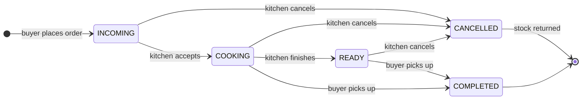

<div align="center">


### Skip the canteen queue. Order ahead, pay with QRIS, pick it up when it's ready.

A pre-order web app for BINUS University canteens, for students, canteen kitchens and campus admins.

[](https://nganteen.vercel.app)


</div>

---

## Why Nganteen?

At lunch, the BINUS canteens get packed: long queues, sold-out menus, and orders shouted across the counter. Nganteen moves the queue online. Students browse every kitchen from their phone, order and pay before they walk over, and watch the order status update live until the food is ready. Kitchens see a clean list of incoming orders instead of a crowd.

## Features

| 🧑‍🎓 Buyers | 🍳 Kitchens | 🛠️ Admin |
|---|---|---|
| Register with a BINUS email and campus | Manage the menu: add, edit, set stock | Add and edit canteen kitchens |
| Browse kitchens and menus by campus | See incoming orders live (refreshes every 5 s) | Set kitchen login credentials |
| Cart, notes and order preview | Move orders: cooking → ready, or cancel | View all orders and accounts |
| Pay by scanning QRIS | Open or close the kitchen, or mark it busy | |
| Track the order live, plus order history | Order history | |
| Save bank account details | Help and contract policy pages | |

**Under the hood**
- 🔒 **Role-based access:** every API route checks the signed-in user's role and ownership, and middleware guards the buyer, kitchen and admin pages.
- 💸 **Server-side prices:** order totals are calculated from the database, never trusted from the browser.
- 📦 **Stock that can't go negative:** stock is taken atomically inside a transaction, and given back when an order is cancelled.
- 🔑 **Hashed passwords:** buyer, kitchen and admin passwords are stored as bcrypt hashes.

## Order flow



## Tech stack

| Layer | Tools |
|---|---|
| App | [Next.js 15](https://nextjs.org) (App Router and route handlers), React 19, TypeScript |
| UI | Tailwind CSS, Radix UI, Lucide icons, React Hook Form and Zod |
| State | Zustand (cart) |
| Auth | [NextAuth](https://next-auth.js.org) credentials provider with JWT sessions, bcrypt |
| Data | PostgreSQL ([Neon](https://neon.tech)), [Drizzle ORM](https://orm.drizzle.team) |
| Tests | Jest |
| Hosting | Vercel |

## Getting started

### Prerequisites

- Node.js 20 or newer
- A PostgreSQL database (a free [Neon](https://neon.tech) project works)

### 1. Install

```bash
git clone https://github.com/keishaaurellyy/nganteen.git
cd nganteen
npm install
```

### 2. Configure environment

```bash
cp .env.example .env
```

| Variable | What it is |
|---|---|
| `DATABASE_URL` | PostgreSQL connection string |
| `NEXTAUTH_SECRET` | Random string that signs sessions, from `openssl rand -base64 32` |
| `NEXTAUTH_URL` | App URL, `http://localhost:3000` locally (Vercel sets this for you) |
| `ADMIN_PASSWORD_HASH` | bcrypt hash of the admin password (see below) |

To create the admin password hash, run this command, type the password at the prompt (it stays hidden) and copy the `$2b$…` line it prints:

```bash
read -rsp "Admin password: " P && echo && node -e "require('bcrypt').hash(process.argv[1], 10).then(console.log)" "$P"; unset P
```

> The admin signs in as `nganteen.binus@gmail.com`, which is set in `src/lib/auth-option.ts`.

### 3. Create the tables

```bash
npx drizzle-kit push
```

### 4. Run

```bash
npm run dev
```

Open [localhost:3000](http://localhost:3000). Buyers sign up at `/buyers/register`, the admin signs in at `/admin/login`, and kitchens created by the admin sign in at `/kitchens/login`.

## Scripts

| Command | Does |
|---|---|
| `npm run dev` | Start the dev server with Turbopack |
| `npm run build` | Production build, which fails on type errors |
| `npm start` | Serve the production build |
| `npm test` | Run the Jest suite |
| `npm run typecheck` | `tsc --noEmit` |
| `npm run lint` | ESLint |

## Project structure

```text
nganteen/
├── drizzle/              # Database schema, relations and migrations
├── public/               # Logos, illustrations, QRIS image
├── scripts/              # One-off SQL scripts
├── src/
│   ├── app/
│   │   ├── admin/        # Admin pages
│   │   ├── buyers/       # Buyer pages: explore, cart, QRIS, orders, profile
│   │   ├── kitchens/     # Kitchen pages: orders, menu, history
│   │   └── api/          # REST route handlers
│   ├── components/       # UI per role, plus shared inputs
│   ├── db/               # Drizzle client
│   ├── lib/              # NextAuth config and the requireUser() guard
│   └── middleware.ts     # Page-level role guard
└── tests/                # Jest tests: API, auth, middleware, schema
```

## Team

Built as a thesis project at **BINUS University** by:

- [Keisha Aurelly](https://github.com/keishaaurellyy)
- [Safira Syahada](https://github.com/firasur)
- [Patrick](https://github.com/PatrickDarmawanR)

---

<div align="center">
Made with 🍜 and too much canteen coffee · <a href="https://nganteen.vercel.app">nganteen.vercel.app</a>
</div>
